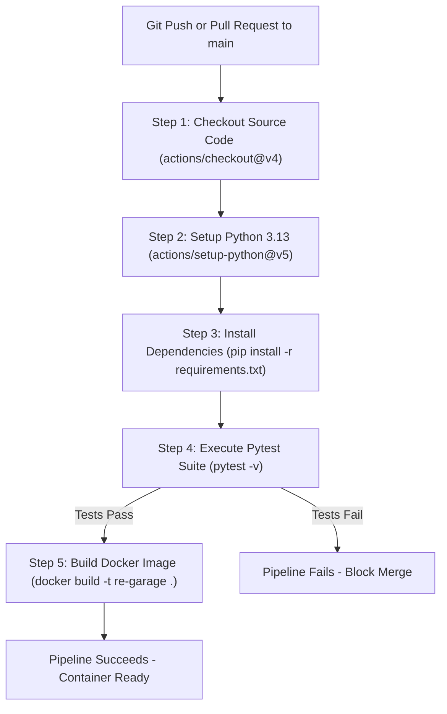

# RE Garage — Sprint Planning & DevOps Architecture

## 1. Story Point Estimation Methodology

We used the standard **Agile Planning Poker** technique based on the **Fibonacci scale** (`1, 2, 3, 5, 8, 13`) to estimate story points considering complexity, uncertainty, and effort:

| Story Points | Complexity Level | Typical Scope in RE Garage |
|:---:|:---:|:---|
| **1 - 2** | Low | Minor UI tweaks, static error templates, navigation links |
| **3** | Moderate | Standalone search filters, service history view, setup scripts |
| **5** | Medium | Standard CRUD module with database schema, validation, forms, and tests |
| **8** | High | Multi-step interactive workflow (dynamic billing with stock deduction, cascading AJAX dropdowns) |
| **13** | Very High | Full cross-system architectural overhaul (broken down into smaller stories) |

---

## 2. Sprint Cycles & Backlog Breakdown

```
┌─────────────────────────────────────────────────────────────────────────────┐
│                           AGILE SPRINT LIFECYCLE                            │
├─────────────────────────┬─────────────────────────┬─────────────────────────┤
│        SPRINT 1         │        SPRINT 2         │        SPRINT 3         │
│     (Core & Foundation) │    (Workflow & Operations)│ (Quality & DevOps)    │
│  Planned: 23 Points     │  Planned: 24 Points     │  Planned: 16 Points     │
│  Completed: 23 Points   │  Completed: 24 Points   │  Completed: 16 Points   │
│  Status: ✅ 100% Done   │  Status: ✅ 100% Done   │  Status: ✅ 100% Done   │
└─────────────────────────┴─────────────────────────┴─────────────────────────┘
```

### Sprint 1: Project Setup, Foundation & Entity CRUD
- **Sprint Goal:** Establish clean Flask application architecture, database models, secure admin authentication, dynamic dashboard, and customer/motorcycle registries.
- **Sprint Duration:** 2 Weeks
- **Sprint Backlog:**

| Task ID | Task Description | Assignee / Role | Estimate | Actual | Status |
|---|---|---|:---:|:---:|:---:|
| S1-01 | Setup Flask app factory, config, SQLite, and base Jinja templates | Full-Stack Dev | 3 pts | 3 pts | ✅ Done |
| S1-02 | Implement SQLAlchemy database models and seed script | Database Dev | 5 pts | 5 pts | ✅ Done |
| S1-03 | Build Admin authentication (Flask-Login, Werkzeug hashing, /init-admin) | Security Dev | 5 pts | 5 pts | ✅ Done |
| S1-04 | Construct live operational dashboard with real database metrics | Frontend Dev | 5 pts | 5 pts | ✅ Done |
| S1-05 | Implement Customer management (CRUD, validation, safe deletion) | Full-Stack Dev | 5 pts | 5 pts | ✅ Done |
| **Total** | | | **23 pts** | **23 pts** | **Velocity: 23** |

---

### Sprint 2: Service Workflow, Inventory & Invoicing
- **Sprint Goal:** Build the service booking lifecycle, spare parts inventory control, and billing system with inventory deduction.
- **Sprint Duration:** 2 Weeks
- **Sprint Backlog:**

| Task ID | Task Description | Assignee / Role | Estimate | Actual | Status |
|---|---|---|:---:|:---:|:---:|
| S2-01 | Motorcycle management with unique registration plates and model catalog | Full-Stack Dev | 3 pts | 3 pts | ✅ Done |
| S2-02 | Service booking module with status transitions (`Pending` -> `In Progress` -> `Completed`) | Backend Dev | 8 pts | 8 pts | ✅ Done |
| S2-03 | Spare parts inventory tracking with low-stock warnings and REST endpoint | Backend Dev | 5 pts | 5 pts | ✅ Done |
| S2-04 | Interactive billing system: dynamic line items, auto math, stock deduction | Full-Stack Dev | 8 pts | 8 pts | ✅ Done |
| **Total** | | | **24 pts** | **24 pts** | **Velocity: 24** |

---

### Sprint 3: Service History, Pytest Suite, Docker & GitHub Actions CI
- **Sprint Goal:** Complete historical lookup, write automated test cases, containerize using Docker, and configure GitHub Actions CI.
- **Sprint Duration:** 2 Weeks
- **Sprint Backlog:**

| Task ID | Task Description | Assignee / Role | Estimate | Actual | Status |
|---|---|---|:---:|:---:|:---:|
| S3-01 | Service history module with registration search and past invoice linking | Frontend Dev | 3 pts | 3 pts | ✅ Done |
| S3-02 | Write Pytest automated test suite covering auth, CRUD, billing, and inventory | QA Engineer | 5 pts | 5 pts | ✅ Done |
| S3-03 | Create multi-stage Dockerfile, compose.yaml, and persistent volume mount | DevOps Engineer | 5 pts | 5 pts | ✅ Done |
| S3-04 | Configure GitHub Actions CI workflow for test execution and Docker builds | DevOps Engineer | 3 pts | 3 pts | ✅ Done |
| **Total** | | | **16 pts** | **16 pts** | **Velocity: 16** |

---

## 3. Comprehensive Testing Table

| Test Case | Module | Input / Action | Expected Result | Actual Result | Status |
|:---:|:---:|:---|:---|:---|:---:|
| **TC-01** | Auth | Unauthenticated GET `/dashboard` | Redirects (302) to `/login` | Redirected to `/login` | ✅ Pass |
| **TC-02** | Auth | POST `/login` with `admin` / `admin123` | Session initialized, redirect to dashboard | Welcome alert, redirected | ✅ Pass |
| **TC-03** | Auth | POST `/login` with incorrect password | Flash danger error, re-renders login | "Invalid username or password" | ✅ Pass |
| **TC-04** | Dashboard | Authenticated GET `/dashboard` | HTTP 200, displays dynamic customer/bike counts | All cards render live DB numbers | ✅ Pass |
| **TC-05** | Customer | POST `/customers/add` with valid payload | New row in `customers` table, redirect 302 | Customer stored and displayed | ✅ Pass |
| **TC-06** | Customer | GET `/customers/?q=Vikram` | Returns customer matching query | Table filters to matching customer | ✅ Pass |
| **TC-07** | Customer | POST `/customers/<id>/delete` when active booking exists | Block deletion with warning flash alert | Deletion aborted, error displayed | ✅ Pass |
| **TC-08** | Motorcycle | POST `/motorcycles/add` with duplicate plate | Rejects submission with error banner | Duplicate error flashed | ✅ Pass |
| **TC-09** | Motorcycle | GET `/motorcycles/by-customer/<id>` | Returns JSON array of customer bikes | JSON payload with id, plate, model | ✅ Pass |
| **TC-10** | Booking | POST `/bookings/create` | Booking status initialized to `Pending` | Stored in database with ID | ✅ Pass |
| **TC-11** | Booking | POST `/bookings/<id>/update-status` (`In Progress`) | Booking status column updated in database | Status updated, alert displayed | ✅ Pass |
| **TC-12** | Inventory | Check `part.is_low_stock` when qty <= min | Property evaluates to `True` | Red warning badge shown | ✅ Pass |
| **TC-13** | Billing | POST `/billing/create` with spare parts | Deducts part quantity, calculates grand total | Stock decremented, bill generated | ✅ Pass |
| **TC-14** | Billing | Attempt duplicate invoice on same booking | Rejects creation, redirects to existing invoice | Duplicate invoice prevented | ✅ Pass |
| **TC-15** | Billing | Request part quantity greater than available stock | Rejects creation with "Insufficient stock" alert | Stock checked, transaction rolled back | ✅ Pass |
| **TC-16** | History | GET `/history/?q=MH-12-RE-1901` | Displays completed booking and invoice link | Matching service card rendered | ✅ Pass |

---

## 4. Git Version Control Workflow

The project uses a structured **Git Feature Branch Workflow**:

```
main (Protected / Production-ready)
 │
 ├── [commit] Initial repository scaffolding & requirements
 ├── [commit] Sprint 1: Models, Auth, Dashboard, Customer & Motorcycle modules
 ├── [commit] Sprint 2: Booking workflow, Inventory tracking, Dynamic Billing
 └── [commit] Sprint 3: Pytest test suite, Dockerfile, compose.yaml, CI workflow
```

### Git Rules & Best Practices:
1. **Branch Protection:** No direct, untested commits pushed to `main`.
2. **Atomic Commits:** Each commit represents a cohesive feature or bug fix with descriptive messages.
3. **Exclusion Hygiene:** `.gitignore` actively excludes `venv/`, `instance/*.db`, `.env`, and `__pycache__/`.

---

## 5. Docker Architecture & Containerization Strategy

```
┌────────────────────────────────────────────────────────────────────────┐
│                          DOCKER HOST SYSTEM                            │
│                                                                        │
│   Port Mapping: Host 5000 ──────────► Container Port 5000              │
│                                                                        │
│  ┌──────────────────────────────────────────────────────────────────┐  │
│  │                    CONTAINER: re-garage                          │  │
│  │                                                                  │  │
│  │   Base: python:3.13-slim                                         │  │
│  │   WSGI: Gunicorn (2 Workers, 120s timeout)                       │  │
│  │   Entry: run:app (Flask Application Factory)                     │  │
│  │                                                                  │  │
│  │   Directory: /app                                                │  │
│  │   Instance Path: /app/instance ◄──────────┐                      │  │
│  └───────────────────────────────────────────┼──────────────────────┘  │
│                                              │ Mount                   │
│  ┌───────────────────────────────────────────┴──────────────────────┐  │
│  │             PERSISTENT VOLUME: re_garage_data                    │  │
│  │             Stores: /app/instance/re_garage.db                   │  │
│  └──────────────────────────────────────────────────────────────────┘  │
└────────────────────────────────────────────────────────────────────────┘
```

### Why Persistent Volume is Critical:
Without the `re_garage_data` named volume, restarting or rebuilding the container (`docker compose down && docker compose up --build`) would destroy the container's writable filesystem layer and erase all customer records and invoices. The volume persists the SQLite database on the host machine across container lifecycles.

---

## 6. GitHub Actions CI Pipeline Explanation

The workflow defined in `.github/workflows/ci.yml` automates regression testing and build verification:



### Key Highlights for College Viva:
- **Zero Cost:** Uses standard GitHub-hosted `ubuntu-latest` runners.
- **Fail-Fast Safety:** Docker build only triggers if 100% of the unit and integration tests pass.
- **Consistency:** Uses Python 3.13 in CI, matching both the local developer machine and the Docker container base image.
